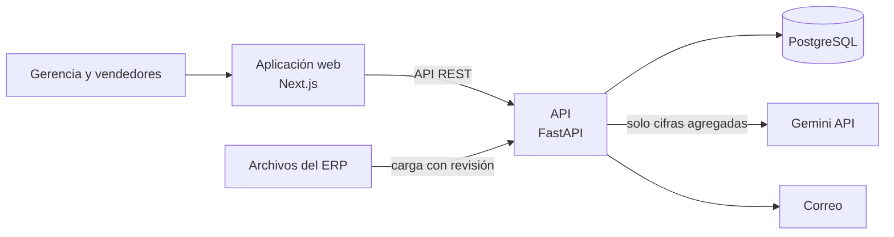

# VetChain

**Plataforma de inteligencia comercial para distribuidoras veterinarias.**

VetChain reúne en una sola aplicación web los datos comerciales de la empresa: clientes, pedidos, productos, stock, cobros y vendedores. Así, gerencia y el equipo de ventas deciden con datos a quién contactar, qué cotizar y cómo va el negocio.

## El MVP

- **Clientes:** cartera ordenada por volumen y nivel, ficha de cada cliente con su historial y detección de clientes en riesgo y dormidos.
- **Cotizaciones:** precios de referencia, vista previa y emisión, con aprobación cuando el descuento o el margen lo exigen.
- **Reportes:** panel gerencial, indicadores clave y reportes de pedidos, clientes, stock, cobranza y vendedores.
- **Ficha para reunión:** resumen del cliente en PDF, listo para compartir por correo o WhatsApp.
- **Carga de datos:** importación de los archivos del ERP con revisión previa, sin borrar información.
- **IA aplicada:** preguntas en lenguaje natural sobre los datos y explicaciones de por qué conviene contactar a un cliente.
- **Predicción:** probabilidad de recompra por cliente, para priorizar el trabajo comercial del día.

## Principios

- **Sin falsa certeza.** Cada cifra indica su origen (real, estimado, sintético o simulado) y la plataforma avisa cuando faltan datos para una conclusión confiable.
- **Cada rol ve lo suyo.** Gerencia ve toda la cartera; cada vendedor, solo la suya.
- **Privacidad primero.** La IA solo recibe cifras agregadas: nunca nombres de clientes ni documentos de identidad.

## Repositorios

| Repositorio | Qué contiene | Tecnología |
|---|---|---|
| [vetchain-platform](https://github.com/VetChain-IAthon/vetchain-platform) | API, reglas del negocio, carga de datos, IA y correo | FastAPI · SQLAlchemy · PostgreSQL · Alembic |
| [vetchain-web-application](https://github.com/VetChain-IAthon/vetchain-web-application) | Aplicación web | Next.js · React · TypeScript · Tailwind CSS · Recharts |

## Arquitectura

La API es un **monolito modular por capas**: módulos independientes (clientes, cotizaciones, reportes, ajustes, carga de datos, correo, predicción y explicaciones), cada uno con dominio, aplicación, infraestructura e interfaz.

---

Proyecto desarrollado por el equipo **VetChain IAthon**.
