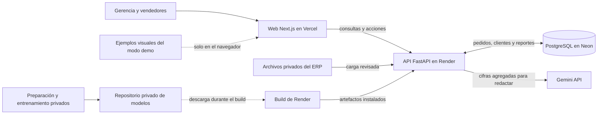
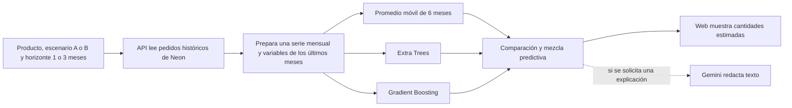

# VetChain

**Plataforma de inteligencia comercial para distribuidoras veterinarias.**

VetChain reúne en una sola aplicación web los datos comerciales de la empresa: clientes, pedidos, productos, stock, cobros y vendedores. Así, gerencia y el equipo de ventas deciden con datos a quién contactar, qué cotizar y cómo va el negocio.

## El MVP

- **Clientes:** cartera ordenada por volumen y nivel, ficha de cada cliente con su historial y detección de clientes en riesgo y dormidos.
- **Cotizaciones:** precios de referencia, vista previa y emisión, con aprobación cuando el descuento supera el límite configurado.
- **Reportes:** panel gerencial, indicadores clave y reportes de pedidos, clientes, stock, cobranza y vendedores.
- **Ficha para reunión:** resumen del cliente en PDF, listo para compartir por correo o WhatsApp.
- **Carga de datos:** importación de los archivos del ERP con revisión previa, sin borrar información.
- **IA generativa:** Gemini puede redactar respuestas y explicaciones a partir de cifras calculadas por la API; no calcula ni modifica esas cifras.
- **Pronóstico por producto:** compara un promedio móvil con un modelo predictivo para estimar cantidades solicitadas a uno o tres meses. La probabilidad de recompra por cliente es una línea de trabajo pendiente.

## Principios

- **Sin falsa certeza.** Cada cifra indica su origen (real, estimado, sintético o simulado) y la plataforma avisa cuando faltan datos para una conclusión confiable.
- **Cada rol ve lo suyo.** Gerencia ve toda la cartera; cada vendedor, solo la suya.
- **Privacidad primero.** Los flujos de pronóstico y resúmenes envían a Gemini cifras agregadas, sin nombres ni documentos de identidad de clientes. Las preguntas libres pasan por controles de privacidad antes de enviarse.

## Repositorios

| Repositorio | Qué contiene | Tecnología |
|---|---|---|
| [vetchain-platform](https://github.com/VetChain-IAthon/vetchain-platform) | API, reglas del negocio, carga de datos, pronóstico y conexión con Gemini | FastAPI · SQLAlchemy · PostgreSQL · Alembic |
| [vetchain-web-application](https://github.com/VetChain-IAthon/vetchain-web-application) | Aplicación web y modo de demostración visual | Next.js · React · TypeScript · Tailwind CSS · Recharts |
| [vetchain-models](https://github.com/VetChain-IAthon/vetchain-models) | Artefactos entrenados y metadatos del pronóstico; acceso restringido | scikit-learn · joblib |

## Arquitectura, a alto nivel

El repositorio de modelos **no es otro servidor**. Guarda archivos entrenados que Render descarga durante la construcción del backend con un token de solo lectura. Cuando un usuario consulta un pronóstico, la API lee el historial de pedidos de Neon y ejecuta esos archivos dentro del propio servicio FastAPI. Ni el navegador ni Gemini reciben los artefactos. Si los archivos no quedan instalados, los demás módulos pueden seguir funcionando, pero el pronóstico no estará disponible.

### Qué ocurre al pedir un pronóstico

La **mezcla predictiva** promedia Extra Trees, Gradient Boosting y el promedio móvil. La web también muestra el promedio móvil por separado como referencia. Se estima la **cantidad solicitada en pedidos**, no ventas facturadas ni cuánto importar. Los modelos se entrenan fuera de la aplicación; una consulta normal no vuelve a entrenarlos. La elección del método y sus límites de validación se explican en [la documentación del pronóstico](https://github.com/VetChain-IAthon/vetchain-platform/blob/main/docs/pronosticos.md).

### Datos reales, estimaciones y ejemplos

| En la pantalla | De dónde sale | Cómo interpretarlo |
|---|---|---|
| Historial comercial y métricas disponibles | Pedidos y otras tablas cargadas en Neon desde los archivos del ERP | Datos registrados, sujetos a la cobertura de los archivos recibidos. |
| Pronóstico por producto | Cálculo estadístico y modelo entrenado, aplicados al historial disponible | **Estimado**; no es una venta ni una orden de compra. |
| Explicación con Gemini | Texto generado a partir de cifras que ya calculó la API | **IA generativa**; la fuente de cada respuesta indica si Gemini respondió o se usó un texto de reserva. |
| Gráficos pendientes en modo demo | Ejemplos fijos definidos en el frontend | **Simulado**; no sale de Neon, no alimenta el modelo y no debe presentarse como resultado real. |

El modo demo para gráficos incompletos está **en desarrollo en la web**: se activa con `?demo=1`, se conserva solo en ese navegador y puede apagarse con `?demo=0`. Rellena únicamente vistas de ejemplo marcadas «Simulado»; no inserta filas en Neon. Es distinto del escenario ilustrativo de planificación de importación, que también se identifica como simulado. La API es un **monolito modular por capas**: clientes, cotizaciones, reportes, importación de datos, predicción y explicaciones comparten el mismo servicio, con responsabilidades separadas.

---

Proyecto desarrollado por el equipo **VetChain IAthon**.
